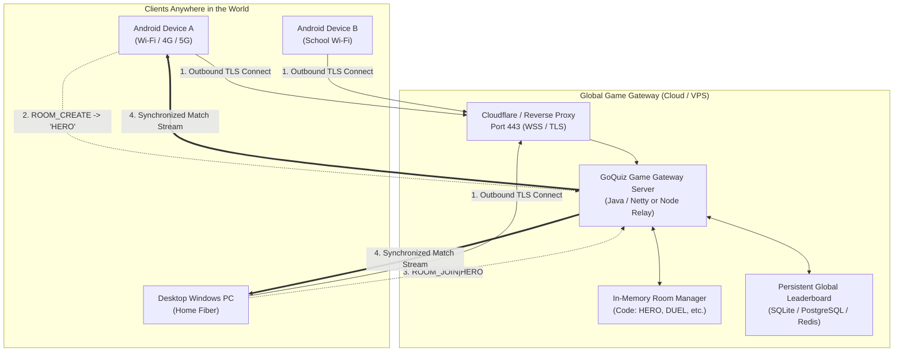

# GoQuiz Adventure — Global Online Multiplayer Architecture Plan

> **Document Version:** 1.0 (Theoretical Architecture & Engineering Roadmap)  
> **Target Platforms:** Android (APK) & Desktop (Windows EXE / Cross-Platform JAR)  
> **Status:** Planning & Architectural Design (No implementation code yet)

---

## 1. Executive Summary & Objective

GoQuiz Adventure currently supports real-time 1v1 PvP duels and shared leaderboards over **Local Area Networks (LAN) & Wi-Fi Hotspots** via `QuizServer.java` (TCP port `5050`, UDP discovery port `5052`).

While LAN play works for players in the same room, it cannot connect players across different locations, cities, or networks (e.g. Player A on home fiber Wi-Fi vs. Player B on mobile 4G/5G data).

The goal of this plan is to design an architecture that allows **anyone, anywhere in the world** to:
1. Tap **"Create Duel"** and receive an easy **4-letter Room Code** (e.g., `HERO`, `QUIZ`, `G077`).
2. Have their friend enter that code from another phone or PC across the internet and instantly start the duel.
3. Compete on a single **Global Hall of Fame Leaderboard** that syncs 24/7.
4. Require **zero IP address typing**, **zero port-forwarding**, and work reliably through school/university firewalls and mobile carrier networks.

---

## 2. Why LAN Multiplayer Fails Over the Global Internet

Understanding the networking barrier is crucial for designing the correct solution:

```
[Phone A (Home Wi-Fi)]               [The Internet]               [Phone B (Mobile 4G/5G)]
Private IP: 192.168.1.15                                          Private IP: 10.45.12.88
          │                                                                  │
          ▼                                                                  ▼
 [Home Wi-Fi Router]                                                [Carrier CGNAT Gateway]
Public IP: 203.0.113.4                                              Public IP: 198.51.100.9
          │                                                                  │
          └─── ❌ BLOCKED: Inbound connection to port 5050 blocked ───────────┘
```

1. **Private Non-Routable Addresses (RFC 1918):**
   `192.168.x.x` and `10.x.x.x` exist only inside a local router. The internet cannot route packets directly to a private IP.
2. **NAT (Network Address Translation) & CGNAT (Carrier-Grade NAT):**
   Mobile phone carriers put thousands of phones behind shared carrier gateways (CGNAT). Phones do not have public IP addresses that accept inbound TCP connections.
3. **Firewalls & Closed Inbound Ports:**
   Home routers and cellular towers automatically reject unsolicited incoming TCP traffic unless explicit port-forwarding rules are configured.
4. **Subnet-Bounded Broadcasts:**
   The current UDP auto-discovery mechanism (`255.255.255.255:5052`) is strictly bounded to the local broadcast domain. Internet routers drop broadcast packets by design.

---

## 3. Architecture Comparison: 5 Global Strategies

| Strategy | How It Works | Strengths | Drawbacks | Recommended? |
| :--- | :--- | :--- | :--- | :--- |
| **Strategy 1: Central Dedicated Server (Relay VPS)** | Host `QuizServer` on a public cloud server (AWS / DigitalOcean / Oracle Free Tier / Render / Fly.io) with a public domain. | • 100% NAT traversal success<br>• Zero configuration for players<br>• Uses our existing Java protocol directly | • Requires maintaining a cloud server ($0–$5/mo) | ⭐ **Highly Recommended (Top Choice)** |
| **Strategy 2: WebSocket over TLS (WSS 443)** | Convert line-based protocol to WebSockets running on standard HTTPS port 443 behind Cloudflare. | • Bypasses strict school/university firewalls<br>• Secure TLS encryption<br>• Enables future Web browser builds | • Needs a WebSocket adapter or minor protocol bridge | ⭐ **Best Long-Term Production Standard** |
| **Strategy 3: Serverless Cloud Backend (Firebase / Supabase)** | Use Firebase Realtime Database or Supabase to manage rooms, scores, and presence without a dedicated game server. | • Zero server maintenance<br>• Free tier covers thousands of daily players<br>• Built-in security rules | • Higher latency (~60-120ms vs 20ms)<br>• Requires adding Firebase Realtime SDK to desktop | 👍 **Viable Alternative** |
| **Strategy 4: P2P NAT Traversal (WebRTC / STUN / TURN)** | Devices connect directly peer-to-peer using STUN hole punching and TURN fallback. | • No gameplay traffic on the central server<br>• Lowest latency if direct | • High complexity in Java Desktop<br>• Symmetric cellular NATs fail and still require a TURN relay | ❌ **Overkill for Quiz Games** |
| **Strategy 5: Auto-Tunneling (Cloudflare Tunnel / ngrok)** | Host runs locally on PC/phone, but opens a reverse tunnel to generate a public domain link. | • No server hosting costs<br>• Completely player-hosted | • Difficult to package on mobile Android<br>• Requires host device to stay awake 24/7 | ❌ **Poor Mobile Experience** |

---

## 4. The Recommended Architecture: Central Cloud Relay + Room Codes

### System Architecture Diagram



### Why This Wins:
1. **Outbound Connections Always Work:** Because clients establish connections *outward* to the cloud server, NAT, CGNAT, and home firewalls allow the traffic seamlessly.
2. **Simple 4-Character Room Codes:** Instead of typing `192.168.1.15:5050`, Host says *"My room code is **FISH**"*. Guest types `FISH` and clicks Join.
3. **Cross-Platform Parity:** Works uniformly on Android, Windows Desktop, macOS, and Linux without platform-specific networking quirks.

---

## 5. Protocol Design & Room Lifecycle

The existing line-based protocol in `QuizServer.java` is already well-structured. It only needs minor adaptations to become global-ready:

### 5.1 Room Creation Flow
```
Host Client                             Cloud Server                            Guest Client
    │                                        │                                       │
    │── HELLO|Alice|Girl|v1.2.1 ────────────>│                                       │
    │<── OK ─────────────────────────────────│                                       │
    │                                        │                                       │
    │── ROOM_CREATE|Alice|Girl|HTML|Easy ───>│                                       │
    │                                        │ [Generates unique 4-char code "LION"] │
    │<── ROOM_CREATED|LION ──────────────────│                                       │
    │                                        │                                       │
    │                                        │<── ROOM_JOIN|LION|Bob|Boy ────────────│
    │<── OPPONENT_JOINED|Bob|Boy ────────────│─── ROOM_JOINED|LION|Alice|Girl ──────>│
    │                                        │                                       │
    │── ROOM_START|payload ─────────────────>│─── DUEL_START|payload ───────────────>│
    │<── DUEL_START|payload ─────────────────│                                       │
    │                                        │                                       │
    │   [Both clients play synchronously, sending SCORE_UPDATE and ANSWER events]    │
```

### 5.2 Heartbeats & Reconnection Resilience
- **Ping/Pong Heartbeat:** Every 10 seconds, client sends `PING`, server responds `PONG`. If no packet arrives for 25 seconds, client marks connection as dropped.
- **Grace Period (15 Seconds):** If a mobile player hits a cellular dead zone or switches Wi-Fi to 4G, their TCP socket drops. The server keeps the room in `PAUSED_RECONNECTING` for 15 seconds instead of immediately terminating the match, allowing the client to send `RECONNECT|LION|Alice` and resume the match seamlessly.

---

## 6. Infrastructure & Hosting Options (Cost & Practicality)

How much does running a global server for GoQuiz cost?

| Provider | Type | Estimated Cost | Capacity | Notes |
| :--- | :--- | :--- | :--- | :--- |
| **Oracle Cloud Free Tier** | Dedicated Compute (ARM / AMD) | **$0 / month** (Always Free) | Up to 10,000+ concurrent players | 4 OCPU, 24GB RAM, static public IP. Unbeatable free performance. |
| **Fly.io / Railway / Render** | Container PaaS | **$0 – $5 / month** | 500 – 2,000 concurrent players | One-click deployment from GitHub repository. Auto-restart and TLS certificates included. |
| **DigitalOcean / Hetzner** | Basic VPS | **$4 – $6 / month** | 5,000+ concurrent players | 100% control, dedicated IPv4 & IPv6, ultra-low latency. |
| **Cloudflare Free Tunnel** | Edge Proxy / TLS | **$0 / month** | Unlimited | Free DDoS protection, SSL termination, and caching. |

> [!NOTE]  
> A quiz game transmits only tiny text strings (approximately 200 bytes per question/answer event). Even with 1,000 active players dueling simultaneously, total bandwidth is less than **1 Mbps**! A $0 free tier server is more than enough for GoQuiz.

---

## 7. Phased Implementation Roadmap

When we are ready to implement global play, the rollout should follow these 4 structured phases:

### Phase 1: Cloud-Ready Server Packaging
- Extract `QuizServer.java` (or create a dedicated `server/` runner) into a standalone runnable JAR/Docker container that can run headless on Linux/Windows.
- Add room code generation: `generateRoomCode()` creates readable 4-character codes (excluding confusing characters like `0`, `O`, `1`, `I`).
- Test deploying to a free cloud instance (e.g. Render / Fly.io / Oracle Cloud).

### Phase 2: Client Connection Fallback (LAN + Global)
- Update Android and Desktop UI with a simple toggle or dual-tab lobby:
  - **Tab 1: 🌐 Global Play (Default)** — Automatically connects to `duel.goquiz.app` (or direct cloud IP). No IP entry required.
  - **Tab 2: 🏠 Local LAN / Offline** — Retains existing LAN server hosting & UDP discovery for schools or rooms with no internet connection.

### Phase 3: Matchmaking & Friend Room System
- **Friend Duel:** Host creates room, gets 4-letter code, shares code with friend.
- **Quick Match (Random Matchmaking):** Player taps "Find Opponent". Server pairs any two waiting players studying the same language/difficulty automatically.

### Phase 4: Security, Anti-Cheat, and Global Leaderboard
- Validate scores server-side (server knows the answer key and ensures points are mathematically valid).
- Sanitize player names to prevent profanity and injection attacks.
- Store the top 100 players in an automated daily/weekly leaderboard database.

---

## 8. Summary & Next Steps

This architecture provides the ideal balance:
- **Zero Friction for Players:** No IP addresses, no router settings — just a 4-letter room code.
- **Backwards Compatibility:** Keeps existing LAN and offline features intact.
- **Minimal Cost:** Easily runs within free-tier cloud limits.

### Status Update:
- **Phase 1 (Implemented):** Standalone cloud server built in [`server/`](./server/) using **Node.js, Express, WebSockets (`ws`), Bun**, and **Supabase (PostgreSQL)**, with **Render 1-click Blueprint** ([`render.yaml`](./render.yaml)).
- **Next Step (Phase 2):** Connecting Android & Desktop clients to the Render WebSocket URL!

